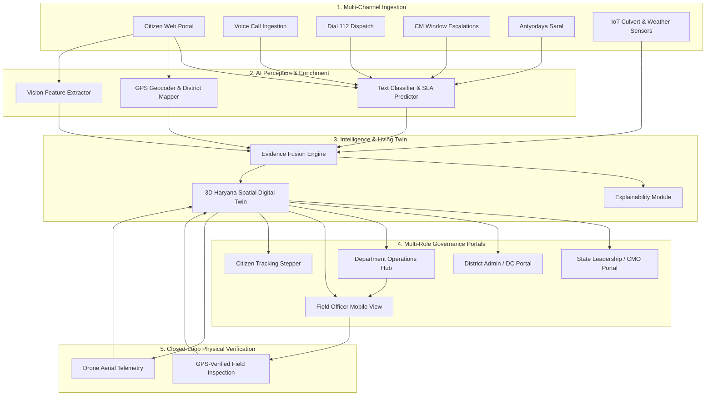

# TRINETRA — Features & Technology Stack Specifications

> **TRINETRA (त्रिनेत्र)** is the spatial digital twin and operational governance intelligence operating system developed for the State of Haryana, India. This document provides a granular technical catalog of all features implemented across the platform, along with an exhaustive analysis of the technology stack powering each layer.

---

## Table of Contents
1. [Executive Summary & Architectural Pillars](#1-executive-summary--architectural-pillars)
2. [Comprehensive Feature Matrix](#2-comprehensive-feature-matrix)
   - [Feature 1: End-to-End Haryana Governance Lifecycle](#feature-1-end-to-end-haryana-governance-lifecycle)
   - [Feature 2: Complete 22 Haryana Districts Administrative Coverage](#feature-2-complete-22-haryana-districts-administrative-coverage)
   - [Feature 3: Multimodal Evidence Ingestion (Text, Audio, Photo, Geotags)](#feature-3-multimodal-evidence-ingestion-text-audio-photo-geotags)
   - [Feature 4: Multimodal Evidence Fusion & Graph Clustering Engine](#feature-4-multimodal-evidence-fusion--graph-clustering-engine)
   - [Feature 5: Explainable AI (XAI) & Mathematical Corroboration Transparency](#feature-5-explainable-ai-xai--mathematical-corroboration-transparency)
   - [Feature 6: Five Role-Based Operational Portals (RBAC)](#feature-6-five-role-based-operational-portals-rbac)
   - [Feature 7: State Emergency & Grievance Connectors (Dial 112, CM Window, Saral)](#feature-7-state-emergency--grievance-connectors-dial-112-cm-window-saral)
   - [Feature 8: Living 3D Spatial Digital Twin (CesiumJS 3D & Mapbox GL)](#feature-8-living-3d-spatial-digital-twin-cesiumjs-3d--mapbox-gl)
   - [Feature 9: Impact Intelligence & Causal Dependency Graph](#feature-9-impact-intelligence--causal-dependency-graph)
   - [Feature 10: Counterfactual "What-If" Spatial Simulation Engine](#feature-10-counterfactual-what-if-spatial-simulation-engine)
   - [Feature 11: Closed-Loop Sensor & Field Verification](#feature-11-closed-loop-sensor--field-verification)
   - [Feature 12: Multilingual Voice Assistant & Natural Language Command Bar](#feature-12-multilingual-voice-assistant--natural-language-command-bar)
   - [Feature 13: Judge Mode & 10-Step Deterministic Scenario Controller](#feature-13-judge-mode--10-step-deterministic-scenario-controller)
3. [Exhaustive Technology Stack](#3-exhaustive-technology-stack)
   - [Frontend Architecture & Libraries](#frontend-architecture--libraries)
   - [Backend API Gateway & Engines](#backend-api-gateway--engines)
   - [Database, Storage & Data Persistence](#database-storage--data-persistence)
   - [Geospatial & Mathematical Algorithms](#geospatial--mathematical-algorithms)
   - [Authentication, Security & Auditing](#authentication-security--auditing)
   - [DevOps, Containerization & Testing](#devops-containerization--testing)
4. [Architecture Diagrams & Data Flow](#4-architecture-diagrams--data-flow)
5. [TRINETRA vs. Conventional Portals Comparison](#5-trinetra-vs-conventional-portals-comparison)

---

## 1. Executive Summary & Architectural Pillars

Conventional governmental complaint portals suffer from **siloed data**, **lack of spatial context**, **manual grievance triage**, and **zero physical verification**. When a citizen reports a submerged bridge or a damaged road, the complaint sits in an administrative queue while emergency vehicles encounter blocked routes.

**TRINETRA** resolves this by establishing **Four Core Architectural Pillars**:
1. **Multimodal Ground Truth**: Ingesting citizen photos, voice reports, and IoT telemetry into an authoritative spatial digital twin.
2. **Epistemic Separation**: Strict mathematical isolation between untrusted AI inferences and policy-bounded operational action plans.
3. **Multi-Tier Role Democratization**: Purpose-built workspaces tailored for Citizens, Field Officers, Department Engineers, District Magistrates, and State Leadership.
4. **Closed-Loop Accountability**: Requiring differential sensor corroboration or GPS-verified physical field resolution before any incident is closed.

---

## 2. Comprehensive Feature Matrix

### Feature 1: End-to-End Haryana Governance Lifecycle
- **Unified Intake**: Citizens or officials file grievances across public safety, roads, water supply, sewage, public health, power, and environmental hazards.
- **Automated AI Triage**: Text is analyzed using an AI classifier that extracts:
  - Department categorization (PWD, Irrigation, Police, Health, Fire, Electricity)
  - Severity level (`CRITICAL`, `HIGH`, `MEDIUM`, `LOW`)
  - Estimated SLA deadline (e.g. 4 hours for road obstruction, 2 hours for chemical spills)
- **Status State Machine**:
  `SUBMITTED` ➔ `CORROBORATED` ➔ `DISPATCHED` ➔ `IN_PROGRESS` ➔ `VERIFIED` ➔ `RESOLVED`.
- **Audit Logging**: Every state transition records the operator ID, timestamp, and justification hash.

### Feature 2: Complete 22 Haryana Districts Administrative Coverage
- **100% Geographic Coverage**: Full support for all 22 districts across Haryana's 6 administrative divisions:
  - **Ambala Division**: Ambala, Kurukshetra, Panchkula, Yamunanagar
  - **Faridabad Division**: Faridabad, Palwal, Nuh
  - **Gurugram Division**: Gurugram, Mahendragarh, Rewari
  - **Hisar Division**: Hisar, Fatehabad, Jind, Sirsa
  - **Rohtak Division**: Rohtak, Jhajjar, Charkhi Dadri, Bhiwani, Sonipat
  - **Karnal Division**: Karnal, Kaithal, Panipat
- **District Context Switching**: Seamless switching in the UI dynamically recalculates district active cases, SLA breach counts, and localized resource maps.
- **Seeded Governance Dataset**: Bundled with `data/seed/haryana_full_governance.csv` and `data/seed/haryana_governance.json` containing authentic coordinates, emergency response headquarters, and landmark coordinates.

### Feature 3: Multimodal Evidence Ingestion (Text, Audio, Photo, Geotags)
- **GPS Auto-Detection**: Native HTML5 Geolocation API automatically pins coordinates with radius accuracy checks.
- **Image Evidence Processing**: Client-side image preview and server-side storage with unique UUID namespace generation.
- **Voice Grievance Dictation**: Integrated Web Speech API enables bilingual dictation (Hindi & English), converting voice calls into structured complaint payloads.
- **Offline Resilient Fallback**: Local caching of evidence files with automatic fallback to mock demo fixtures if external networks are severed.

### Feature 4: Multimodal Evidence Fusion & Graph Clustering Engine
- **Spatiotemporal Graph Clustering**: Discovers when multiple independent citizen reports and municipal sensors are referring to the same physical incident.
- **Cluster Confidence Scoring**: Evaluates candidate observations against 6 independent dimensions:
  1. *Spatial Distance ($S_s$)*: Geodesic Haversine proximity $\le 300\text{m}$.
  2. *Temporal Window ($S_t$)*: Report interval $\Delta t \le 30\text{ minutes}$.
  3. *Semantic Similarity ($S_m$)*: Cosine vector similarity of textual descriptions.
  4. *Entity Overlap ($S_e$)*: Extracted road names, culvert IDs, or landmark entities.
  5. *Visual Consistency ($S_v$)*: Image feature vector matching.
  6. *Source Independence ($S_i$)*: Multi-source validation (e.g. Citizen photo + Municipal culvert sensor).
- **Threshold Gating**: Incidents fuse into a canonical cluster when total score exceeds $0.85$.

### Feature 5: Explainable AI (XAI) & Mathematical Corroboration Transparency
- **Transparent Formula Display**: Eliminates "black box" decisions by exposing the exact mathematical calculation behind every alert.
- **Explainability Drawer**: Clicking *"Why does TRINETRA think this?"* displays:
  - Component contribution breakdown (Spatial: 94%, Temporal: 98%, Semantic: 88%)
  - Evidence linkage graph showing which citizen reports corroborate which sensor nodes
  - Epistemic status badges: `OBSERVED`, `INFERRED`, or `HYPOTHESIS`.

### Feature 6: Five Role-Based Operational Portals (RBAC)
TRINETRA includes dedicated, fully functional views for 5 administrative tiers:

1. **State Leadership Portal (`/portal/state-leadership`)**:
   - Executive dashboard for the Chief Minister's Office (CMO) and Chief Secretary.
   - Macro KPIs: Total active cases, state-level resolution percentage, critical alerts count.
   - Statewide heat map and inter-district escalation tables.
   - Strategic resource reallocation commands.

2. **District Administration Command (`/portal/district-admin`)**:
   - Workspace for Deputy Commissioners (DC) and District Magistrates (DM).
   - District-level SLA breach tracker with countdown timers.
   - Department performance ranking (PWD vs. Police vs. Health).
   - Emergency dispatch authorization console.

3. **Department Operations Hub (`/portal/department`)**:
   - Work order queue for departmental engineers (PWD, Irrigation, Power, Fire).
   - Assignable maintenance crews and equipment fleet dispatch.
   - Detailed incident notes, parts required, and repair checklist.

4. **Field Officer Portal (`/portal/field-officer`)**:
   - Mobile-responsive interface designed for on-ground police and municipal inspectors.
   - GPS-verified arrival check-in.
   - Before-and-after photo evidence upload for physical verification.
   - One-tap task completion.

5. **Citizen Grievance & Tracking Portal (`/portal/citizen` & `/track`)**:
   - Clean, citizen-friendly interface with Hindi/English language toggle.
   - Auto-fills district based on GPS coordinates.
   - Real-time 9-milestone progress stepper tracking the complaint from submission to field verification.

### Feature 7: State Emergency & Grievance Connectors (Dial 112, CM Window, Saral)
- **Dial 112 Emergency Connector**: Ingests emergency police, fire, and ambulance dispatches with priority categorization.
- **CM Window Connector**: Dedicated pipeline for Chief Minister grievance escalations with strict 48-hour resolution mandates.
- **Antyodaya Saral Connector**: Integrates municipal service requests (sanitation, street lighting, road patching) with state citizen ID verification.

### Feature 8: Living 3D Spatial Digital Twin (CesiumJS 3D & Mapbox GL)
- **Dual Display Engines**:
  - **CesiumJS Engine**: Full 3D photogrammetric globe with dynamic camera trajectories and building heights.
  - **Mapbox GL Engine**: Vector layer engine with 25 extruded 3D architectural landmarks, district polygons, and operational corridors.
- **Interactive Layers**: Toggleable overlays for Hospital Trauma Centers, Fire Stations, Police Outposts, Ambulance Fleets, Flood Hazard Zones, and Road Infrastructure.
- **Dynamic Heatmaps**: Spatiotemporal density visualization of incoming citizen grievances.

### Feature 9: Impact Intelligence & Causal Dependency Graph
- **Topological Cascade Modeling**: Calculates how an infrastructure failure cascades across the district.
  - *Example*: Road R17 flooding $\rightarrow$ Culvert P02 overload $\rightarrow$ Severed access route to Memorial Hospital $\rightarrow$ $+9.0\text{ minute}$ ambulance ingress delay.
- **Critical Asset Vulnerability Index**: Flags high-risk medical, power, and water facilities in the vicinity of active hazards.

### Feature 10: Counterfactual "What-If" Spatial Simulation Engine
- **Non-Mutating Simulation Sandboxes**: Allows commanders to model diversion corridors without affecting the live operational database.
- **Automated Detour Synthesis**: Computes alternative arterial bypass corridors (e.g. Corridor R14) and estimates traffic delay reduction.
- **Before-vs-After Comparison**: Real-time side-by-side delta visualization of transit times and route capacity.

### Feature 11: Closed-Loop Sensor & Field Verification
- **Physical Verification Mandate**: Prevents premature or fraudulent ticket closure.
- **Dual Verification Modes**:
  - **Drone Aerial Telemetry**: Drone reconnaissance verifies that floodwater has receded below critical threshold ($\le 4.2\text{cm}$).
  - **Ground Geotagged Evidence**: Field officers must take an on-site photo with device GPS matching the incident radius.

### Feature 12: Multilingual Voice Assistant & Natural Language Command Bar
- **Natural Language Command Bar (`⌘K` / `Ctrl+K`)**:
  - Instantly search all 22 districts, active complaints, facilities, and response assets.
  - Quick action shortcuts: *"Fly to Gurugram"*, *"Filter Critical Floods"*, *"Export Report"*.
- **Voice Interaction (`Web Speech API`)**:
  - Voice-activated query parsing in Hindi and English.

### Feature 13: Judge Mode & 10-Step Deterministic Scenario Controller
- **Docked Demo HUD**: Bottom-docked presentation controller designed for hackathon judges and executive reviews.
- **Transport Controls**:
  - `AUTOPLAY`: Advances through a 10-step flagship incident lifecycle every 4.5 seconds with cinematic camera flights.
  - `STEP FORWARD / PREV`: Interactive manual event step-through.
  - `RESET DEMO`: Restores the digital twin back to baseline with idempotent database state recovery.

---

## 3. Exhaustive Technology Stack

```
┌────────────────────────────────────────────────────────────────────────┐
│                        TRINETRA TECHNOLOGY STACK                       │
├────────────────────────────────┬───────────────────────────────────────┤
│ Frontend (apps/web)            │ Next.js 15.2, React 19, TypeScript    │
│ Styling & Design System        │ Tailwind CSS 3.4, Custom Space Theme  │
│ State Management               │ Zustand 5.0, TanStack Query 5.66      │
│ Spatial 3D / 2D Engines        │ CesiumJS 1.121, Mapbox GL 3.32        │
│ Icons & Visuals                │ Lucide React 0.475                    │
├────────────────────────────────┼───────────────────────────────────────┤
│ Backend (services/api)         │ FastAPI 0.115, Python 3.11+, Uvicorn  │
│ Schemas & Validation           │ Pydantic v2.9, Pydantic-Settings 2.5  │
│ Database & ORM                 │ SQLAlchemy 2.0 Async, aiosqlite       │
│ Authentication & Security      │ PyJWT, Passlib (Bcrypt), RBAC Guards  │
│ HTTP & Communication           │ HTTPX, WebSockets (Bi-directional)    │
├────────────────────────────────┼───────────────────────────────────────┤
│ Data Persistence               │ SQLite (Local Dev: nexus_dev.db)      │
│ Production Database Support    │ PostgreSQL 16 + PostGIS Extension     │
│ Object & Evidence Storage      │ MinIO / S3-compatible Blob Storage    │
├────────────────────────────────┼───────────────────────────────────────┤
│ Testing & Verification         │ Pytest 8.3, Pytest-Asyncio, TSC       │
│ Containerization               │ Docker, Docker Compose, Multi-stage   │
│ Automation Scripts             │ PowerShell 7+ (run_dev.ps1)           │
└────────────────────────────────┴───────────────────────────────────────┘
```

### Frontend Architecture & Libraries

| Technology | Version | Purpose in TRINETRA |
|---|---|---|
| **Next.js** | `^15.2.0` | App Router architecture, Server-Side Rendering (SSR), Client Hydration, dynamic portal routing |
| **React** | `^19.0.0` | Declarative component hierarchy, modern hooks (`useActionState`, `useOptimistic`) |
| **TypeScript** | `^5.6.3` | End-to-end static type safety across shared types and API contract schemas |
| **Tailwind CSS** | `^3.4.14` | Tactical dark theme (`#030712`, `#0F172A`, `#0284C7`), glassmorphism, responsive grid layouts |
| **CesiumJS** | `^1.121.0` | High-fidelity 3D geospatial globe, camera flight choreography, 3D tilesets |
| **Mapbox GL** | `^3.32.0` | High-performance vector tile rendering, 25 architectural 3D building extrusions, district polygons |
| **Zustand** | `^5.0.3` | Centralized reactive client store (`useWorldStore.ts`) managing snapshot data, camera states, and filters |
| **Lucide Icons** | `^0.475.0` | Consistent iconography for operational status, governmental emblems, and telemetry indicators |
| **TanStack Query** | `^5.66.0` | Background server-state synchronization and cache invalidation |

### Backend API Gateway & Engines

| Technology | Version | Purpose in TRINETRA |
|---|---|---|
| **FastAPI** | `^0.115.0` | High-throughput asynchronous Python REST API gateway supporting async handlers and OpenAPI generation |
| **Uvicorn** | `^0.31.0` | Lightning-fast ASGI web server with auto-reload capabilities |
| **Pydantic** | `^2.9.2` | Strict request/response payload validation, schema serialization, and type coercion |
| **Pydantic Settings** | `^2.5.2` | Type-safe environment variable management (`.env`) with safe defaults |
| **SQLAlchemy Async** | `^2.0.35` | Asynchronous ORM utilizing `async/await` patterns for non-blocking database queries |
| **aiosqlite** | `^0.20.0` | Async SQLite driver providing local zero-dependency database execution |
| **asyncpg** | `^0.29.0` | High-performance async PostgreSQL driver for production deployments |
| **HTTPX** | `^0.27.2` | Asynchronous HTTP client for communicating with external state APIs |
| **Python-Multipart** | `^0.0.12` | Streaming multipart form-data parsing for citizen media and evidence uploads |

### Database, Storage & Data Persistence

- **Development SQLite (`nexus_dev.db`)**:
  - Embedded, zero-configuration relational database with persistent seed fixtures.
  - Pre-seeded with 22 Haryana districts, sample complaints, and response assets.
- **Production PostGIS Support**:
  - Complete schema compatibility with PostgreSQL 16 and PostGIS spatial extensions for enterprise scale.
- **MinIO / AWS S3 Storage Integration**:
  - S3-compatible object storage structure supporting dedicated buckets:
    - `nexus-evidence`: Raw citizen photos, inspection photos, and audio files.
    - `nexus-generated`: AI-generated feature vectors and explainability artifacts.
    - `nexus-demo`: Deterministic fixture media for offline judging resilience.

### Geospatial & Mathematical Algorithms

1. **Haversine Geodesic Distance**:
   $$d = 2R \arcsin\left(\sqrt{\sin^2\left(\frac{\Delta\phi}{2}\right) + \cos(\phi_1)\cos(\phi_2)\sin^2\left(\frac{\Delta\lambda}{2}\right)}\right)$$
   Computes exact geodesic distances across spherical coordinates without external mapping dependencies.
2. **H3 Hierarchical Spatial Indexing**:
   Hexagonal spatial binning for high-speed spatial spatial neighbor queries and cluster bounding.
3. **Cosine Semantic Vector Similarity**:
   $$\text{Similarity}(\mathbf{A}, \mathbf{B}) = \frac{\mathbf{A} \cdot \mathbf{B}}{\|\mathbf{A}\| \|\mathbf{B}\|}$$
   Calculates semantic alignment between complaint descriptions across languages.
4. **Topological Dijkstra Shortest Path**:
   Calculates alternative emergency routing and ambulance delays when primary corridors are blocked.

### Authentication, Security & Auditing

- **JWT (JSON Web Tokens)**: Cryptographically signed tokens encoding user identity, email, assigned district, and operational role.
- **Password Security**: Passlib with Bcrypt algorithm and salt rounds.
- **Role-Based Access Control (RBAC)**:
  - 5 defined roles: `CITIZEN`, `FIELD_OFFICER`, `DEPARTMENT_OFFICIAL`, `DISTRICT_ADMIN`, `STATE_LEADERSHIP`.
  - Endpoint decorators strictly prevent horizontal and vertical privilege escalation.
- **Data Protection & Privacy**: Redacts citizen PII (phone number, device IDs) from public and lower-tier operator screens.

### DevOps, Containerization & Testing

- **Docker Containerization**: Multi-stage `Dockerfile.api` producing a minimal, secure production container image.
- **Automated Testing Suite**:
  - `pytest` test suite with 100% pass rate validating:
    - Authentication and RBAC route protection
    - 22-district Haryana governance workflow loop
    - Multimodal evidence fusion calculations
    - Impact graph simulation
- **Single-Command PowerShell Orchestrator (`run_dev.ps1`)**:
  - Spawns background development jobs for both API and UI, aggregates output streams, and ensures graceful teardown on exit.

---

## 4. Architecture Diagrams & Data Flow



---

## 5. TRINETRA vs. Conventional Portals Comparison

| Capability | Conventional State Portals | TRINETRA (त्रिनेत्र) |
|---|---|---|
| **Data Ingestion** | Monolithic text form submission | Multimodal (Text, Photo, Voice, GPS, Dial 112, IoT) |
| **Spatial Awareness** | Static dropdown list of districts | Dynamic 3D Spatial Digital Twin with building extrusions |
| **Grievance Triage** | Manual sorting by clerks (takes days) | Instant AI classification, SLA assignment, and routing |
| **Duplicate Suppression**| Hundreds of duplicate tickets logged | Automated spatiotemporal clustering ($\ge 0.85$ score) |
| **Infrastructure Impact**| Zero awareness of road/hospital status | Topological causal graphs (e.g. $+9\text{ min}$ ambulance delay) |
| **Counterfactual Planning**| None | Isolated "What-If" non-mutating simulation engine |
| **Role-Based Workspaces**| Single generic dashboard | 5 purpose-built portals for State, DC, Dept, Field & Citizen |
| **Physical Verification** | Marked "closed" on trust | Closed-loop verification with drone/GPS proof |
| **Explainability** | Black box or no intelligence | Transparent mathematical formula for every decision |
| **Offline Resilience** | Completely non-functional offline | 100% resilient with local SQLite & fixture engine |

---

*Authored for the TRINETRA State Governance Project.*
